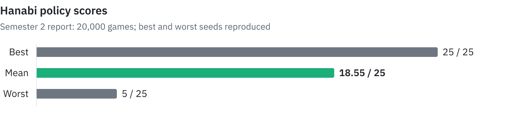

# Multi-agent knowledge tracking

An M1 multi-agent systems project (2025–2026) in Java, applied to Hanabi and a city rendezvous problem. Agents use partial observations and models of other agents' knowledge to choose hints, routes and messages.

<picture>
  <source media="(prefers-color-scheme: dark)" srcset=".github/assets/hanabi-scores-dark.svg">
  
</picture>

## Results

| Scenario | Observed result |
|---|---|
| Hanabi, seed `7950951865960141691` | 25/25, no errors, 6 cards left in the deck |
| Hanabi, seed `-7009734669824303062` | 5/25, no errors, deck exhausted |
| Default city scenario | All 3 agents reach `RDV` after 6 steps, with 1 message left at `Shared` |

The [semester 2 report](rendu/Projet_Agents_S2.pdf), section 2.2.4, reports a mean of 18.55/25 over 20,000 games. The two seeded results above reproduce its best and worst examples; the full benchmark is not included as a runnable script.

## Getting started

Requires Bash, JDK 17 or later and Maven. The simulations print their states and actions in the terminal.

```bash
bash run_hanabi.sh
bash run_ville.sh
bash scripts/hanabi/bonscore.sh
bash scripts/hanabi/pirescore.sh
```

`run_hanabi.sh` uses a random seed; the last two scripts replay the seeds in the results table. `run_ville.sh` runs the mixed second-order reasoning scenario: Alice discovers a closure and leaves a message that helps Bob avoid it, while Charlie follows a separate route.

## How it works

| Package | Role |
|---|---|
| `src/core/` | Simulation loop, joint actions, histories, policies and compatible-state filtering |
| `src/hanabi/` | Card domains, safe plays, discards and hints chosen to reduce another agent's uncertainty |
| `src/ville/` | Graph navigation with BFS, local messages and beliefs about other agents' positions and knowledge |

Each step collects actions, advances the game, then distributes observations. City agents can use `BeliefState`; Hanabi tracks per-card domains inside `PolitiqueSimpleHanabi` instead. To add a scenario, implement `Jeu`, state, actions, observations and a policy, including simulated observations for belief filtering.

## Limitations

Hanabi does not limit hint tokens and stops immediately when the deck is empty. Its scores therefore describe this implementation's rules. The simulations run in the console: the visual tools and benchmark classes mentioned in the generated Javadoc are not in `src/`.

## Credits

Tom David, Titouan Pasquier, Marius Guillais and Maxim Chepy. Reports for both semesters are in [rendu/](rendu/).
